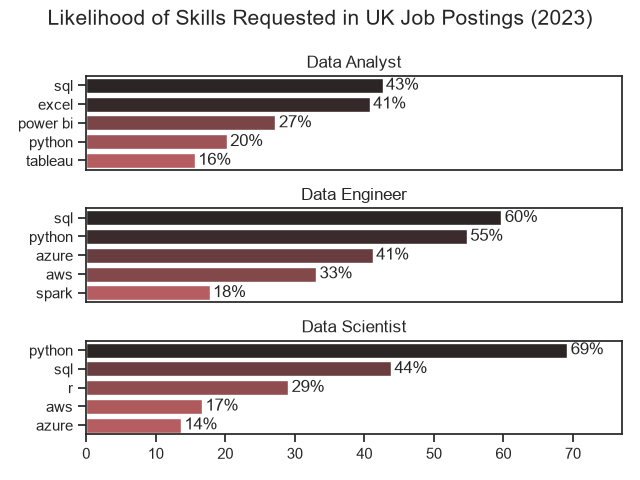
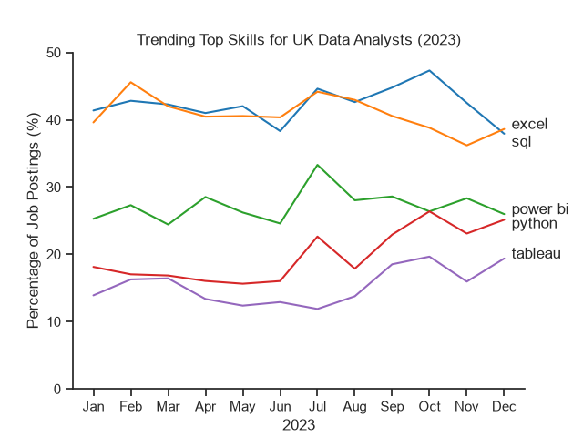

# The Analysis

## 1. What skills were in demand for the top 3 most popular data roles?

I identified the most popular data roles based on the number of job advertisements in 2023. This allowed me to filter for the top 5 skills demanded for the top 3 data roles. This query highlights the most popular job titles and their top skills, showing which skills I should pay attention to depending on the role I am targeting.

View my notebook with detailed steps here:
[2_Skills_Demand.ipynb](3_Project\2_Skills_Demand.ipynb).

### Visualise the Data

```Python
#Set up the plot
fig, ax = plt.subplots(len(job_titles),1)

#For loop to create plot for each job_title item
for i, job_title in enumerate(job_titles):
    
    #Set the theme
    sns.set_theme(style='ticks')
    
    #Subset the data for our top 3 job titles and top 5 skills
    df_plot = df_skill_perc[df_skill_perc['job_title_short'] == job_title].head(5)
    
    #Plot using seaborn
    sns.barplot(data=df_plot, x='skill_perc', y='job_skills', ax=ax[i],         hue='skill_count', palette='dark:r_r')
    ax[i].set_title(job_title)
    ax[i].set_ylabel('')
    ax[i].set_xlim(0,max(df_skill_perc['skill_perc'])*1.05)
    ax[i].set_xlabel('')
    ax[i].legend().set_visible(False)

    #Specify data labels
    for n, v in enumerate(df_plot['skill_perc']):
        ax[i].text(x=v+0.5, y=n, s=f'{v:.0f}%', va='center')
    
    #Set x axis for the 3rd plot only
    if i != 2:
        ax[i].set_xticks([])
    
#Set the figure title and global options
fig.suptitle('Likelihood of Skills Requested in UK Job Postings', fontsize=15)
fig.tight_layout()
plt.show()
```
### Results



### Insights

* SQL and Python are versatile skills which were in demand across Data Analyst, Data Engineer, and Data Scientist roles.
* SQL was the most requested skill amongst Data Analysts (43 %) and Data Engineers (60 %), respectively.
* Data Engineers and Data Scientists required more specialised technical skills (Azure, AWS, Spark) compared to data analysts who are expected to be more proficient in data management and analysts tools (Excel, Power BI, Tableau).

## 2. Demands for Data Analyst skills in 2023


### Visualise the Data

```python
#Subset data for the top 5 skills in each month
df_plot = df_perc.iloc[:,0:5]

#Use Seaborn to create a lineplot
sns.lineplot(data=df_plot, dashes=False, palette='tab10')
sns.set_theme(style='ticks')
sns.despine()

#Format the axes and legend
plt.title('Trending Top Skills for UK Data Analysts (2023)')
plt.xlabel('2023')
plt.ylabel('Percentage of Job Postings (%)')
plt.ylim(0,50)
plt.legend(loc='best', frameon=False, bbox_to_anchor=(1,0.7))

plt.savefig('Figures/Skills_Trend.png')
plt.show()
```

### Results



### Insights

* SQL and Excel were consistently the most popular skills for UK Data Analyst job advertisements in 2023. However, the demand for Excel dipped sharply within the final three months.
* The popularity of Python increased over the course of 2023, particularly in the latter half of the year.
* Tableau, while less in demand compared to other skills, experienced a slight upward trend towards the end of 2023. 
